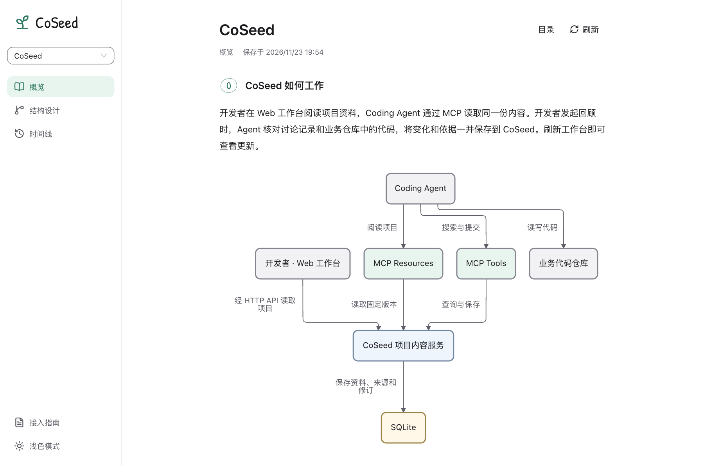
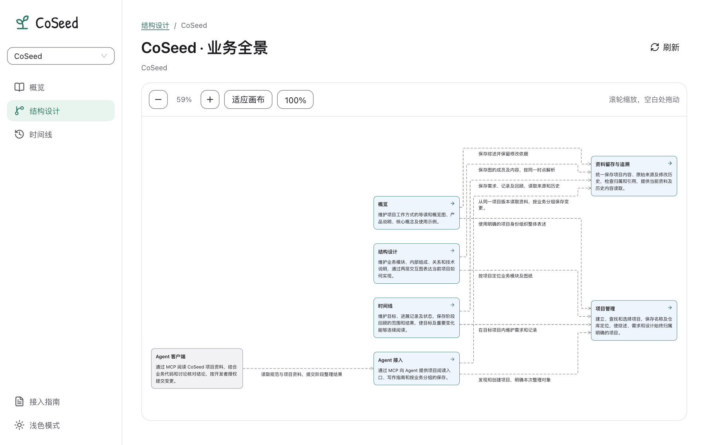
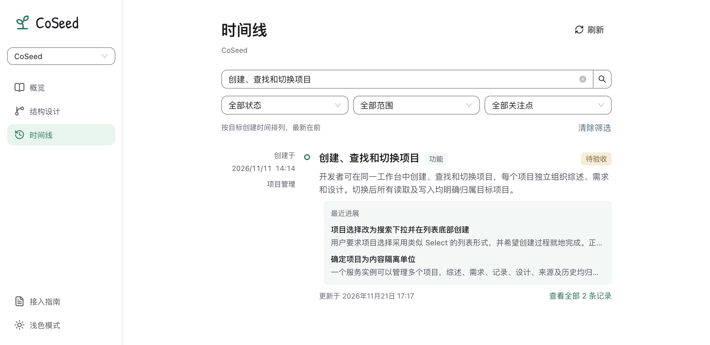

# CoSeed

CoSeed 是一个自托管的项目工作台。你可以请 AI 编程助手回顾一段讨论或一组代码改动，把确定的需求、设计和进展保存在项目里。以后，你可以直接在网页上查阅当时的决定和依据。新会话中的助手也可以通过 MCP 读取同一份资料。

以下三张截图均取自 CoSeed 自身的项目资料。[使用 Docker 启动](#使用-docker-启动)

## 概览

初次接触一个项目，可以从这里了解它做什么、怎样使用。CoSeed 的概览先用一张图说明开发者怎样在网页阅读资料、编程助手怎样读取和更新同一项目，后面再介绍核心概念和使用示例。



## 结构设计

全景图展示项目由哪些模块组成，以及它们怎样配合。在 CoSeed 中，「时间线」负责组织目标和进展记录，「资料留存与追溯」负责保存这些内容及其修改依据。点击模块卡片，可以继续查看模块内部的组成和关系。



## 时间线

每个目标都有自己的推进记录。以「创建、查找和切换项目」为例，较早的记录确定了资料按项目隔离，后一条记录说明查找、切换和创建如何集中到侧栏的项目列表。页面直接显示目标状态和最近两条进展，点进目标可以阅读完整记录。



## 使用 Docker 启动

安装带 Compose 的 Docker，下载或克隆本项目源码，在包含 `compose.yaml` 的目录中运行以下命令。

```sh
docker compose up --build -d --wait
```

打开[本机工作台](http://127.0.0.1:4310)，创建自己的项目。在左侧「接入指南」复制 MCP 地址、生成项目密钥，并将两者填入编程助手的 MCP 设置。每个密钥只授权访问一个项目。

首次启动使用默认配置即可。项目资料保存在 Docker 数据卷中。[端口、备份与更新](docs/operations/deployment.md) · [更换构建下载源](docs/operations/deployment.md#更换构建下载源)

CoSeed 采用 [MIT 许可证](LICENSE)。第三方组件遵循各自的[许可说明](THIRD_PARTY_NOTICES.md)。
