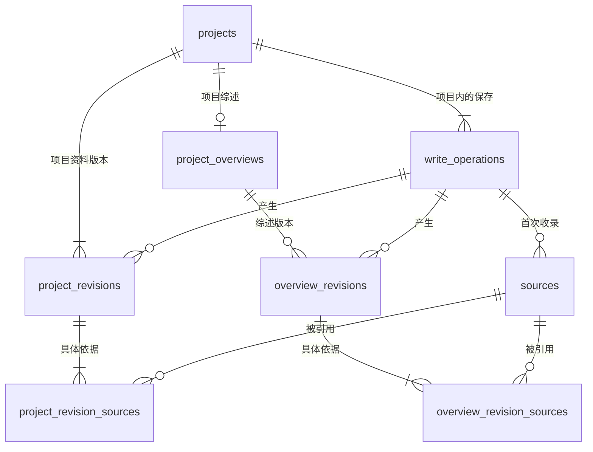

# 项目与综述：首批库表设计

状态：**八张表及业务模块独立演进的方向已确认；字段和约束仍是提案，尚未接入运行时或执行正式迁移。**

本批打通项目和综述的保存、读取、更正及追溯。已确认规则见[业务设计](../requirements/product.md)；本文提出具体存储方案，不把建议当成已经通过的产品决定。可执行草案为 [schema-draft.sql](schema-draft.sql)。

## 1. 核心方案

采用“稳定身份 + 当前版本指针 + 不可变快照”。项目名称、仓库定位放进项目版本；综述正文放进综述版本。当前页面读取指针指定的版本，数据库不再另存一份可覆盖的相同正文。

一次保存有一个写操作，记录执行者、入口、保存时间和重试标识。被更正的具体部分通过引用关联来源原文。一次保存可以同时更新项目信息和综述；写操作不是一次回顾，也不是需求推进记录。

共 8 张表：4 张组织业务对象及版本，2 张保存写操作和来源，2 张保存版本与来源的多对多关系。



图中每个版本至少有一个来源是**保存服务必须校验的规则**，仅靠 SQL 外键不能保证“至少一条子记录”或材料真的支持结论。当前版本指针不另画重复连线，分别在两张身份表中保存。

## 2. 表和字段

约定：`TEXT` 标识为不带业务含义的 ID；建议使用 UUID。所有时间为服务端写入的 UTC Unix 毫秒整数；来源实际发生时间可以为 NULL。数据库不会用保存时间填补未知的发生时间。

### projects：项目身份

| 字段                | 含义                                               |
| ------------------- | -------------------------------------------------- |
| id                  | 项目 ID；不随名称、路径、分支或 worktree 改变      |
| current_revision_no | 当前项目资料版本；创建事务完成时必须指向存在的版本 |
| created_at          | 项目创建时间                                       |

项目 ID 是隔离依据。路径和远程地址都是定位信息，不建立按路径或远程地址自动合并项目的唯一约束。同仓库如何归并项目仍是产品未决事项。

### project_revisions：项目资料快照

| 字段                     | 含义                                                                              |
| ------------------------ | --------------------------------------------------------------------------------- |
| project_id + revision_no | 联合主键；版本在一个项目内从 1 连续递增                                           |
| previous_revision_no     | 上一个版本；首版为空，其后必须等于本版减 1                                        |
| operation_id             | 产生这份版本的写操作                                                              |
| name                     | 当时的项目名称，不能为空                                                          |
| repository_locator_json  | 可选仓库定位描述；例如 remote URL、本地目录、子目录和当时引用，不承担项目身份判断 |

项目资料单独保留快照，改名或修正仓库定位也有历史。这里不重复保存综述中的“产品是什么”。仓库定位字段的正式输入规范需在实现前确认，本提案不预设一个项目只能绑定某条路径。

### project_overviews：综述身份与当前版本

| 字段                | 含义                                         |
| ------------------- | -------------------------------------------- |
| project_id          | 主键，同时关联项目；每个项目最多一份综述身份 |
| current_revision_no | 当前综述版本；尚未编写时为空                 |

建议创建项目时一并创建空的综述身份，但不生成虚假的空白首版；第一次写入真实内容才产生版本 1。允许项目先建立、综述稍后补齐，是本次建议，待确认后实施。

### overview_revisions：综述完整快照

| 字段                     | 含义                                                                   |
| ------------------------ | ---------------------------------------------------------------------- |
| project_id + revision_no | 联合主键                                                               |
| previous_revision_no     | 连续的上一个综述版本                                                   |
| operation_id             | 本次写操作                                                             |
| schema_version           | 内容结构的版本，用于校验和后续兼容                                     |
| content_json             | 本版完整综述，包括产品表述、核心概念、使用示例及相关图形内容           |
| content_hash             | 服务端对规范化内容计算的 SHA-256，用于比较内容，不作为业务身份或唯一键 |

综述内部暂不拆成概念管理、示例管理、图片管理等多组表。它们是一起阅读和维护的文档内容，存为有 Schema 的 JSON；身份、版本、操作、来源和引用使用关系表。

建议的内容组织示意：

```text
综述 content_json
├── product：产品表述 Markdown
├── concepts
│   ├── entries：稳定 ID、名称、解释
│   └── relations：种属、组成、业务关联
└── examples
    ├── introductionMd：共用背景和前提说明
    ├── actors / useCases：共用的角色和用例
    └── sections[]：稳定 ID、小标题、对应图及正文
```

具体字段、引用和可执行校验见[综述内容结构提案](overview-content-design.md)，尚未接入正式业务。SQL 的 JSON 合法性检查不替代内容校验。图中节点、关系和示例拥有稳定 ID，布局坐标不能作为身份；缩进从种属关系推导，不同时保存第二套层级。

快照保留当时内容，差异由前后两版比较得到。恢复旧版时复制其内容形成新版本，指针继续递增，不删除中间历史。原始快照即使结构升级也不改写，读取层通过对应版本的解析器处理。

### write_operations：一次成功保存

| 字段                 | 含义                                                   |
| -------------------- | ------------------------------------------------------ |
| id                   | 建议由调用方为一次逻辑保存生成的 UUID；重试复用同一 ID |
| project_id           | 本次保存唯一所属项目                                   |
| request_hash         | 服务端计算的请求指纹；同一 ID 携带不同请求必须冲突     |
| entrypoint           | 服务端确定的入口：web、mcp、cli、system                |
| actor_kind           | human、agent、system；与入口分开保存                   |
| actor_label          | 执行者显示名称，不冒充原决定提出者                     |
| client_metadata_json | 可选客户端名称、版本、调用方定位等元数据               |
| note_md              | 可选的修改说明                                         |
| saved_at             | 本次保存时间                                           |

本表只记录成功保存；失败事务不留一条伪装成功的操作。写操作 ID 不是 MCP 的 JSON-RPC 消息编号，也不是聊天 ID。

首版本地服务尚无用户认证体系，客户端名称及提交的身份声明不等于已认证的真实身份。入口由服务端记录；人、Agent、原决定提出者如何确认，必须在来源和调用上下文中如实区分。本文不新增用户、租户或权限表。

同一操作 ID 重试：先检查项目及请求指纹，一致则返回已保存结果；不一致则冲突，不再次生成版本。创建项目的重试也复用操作 ID，不能因项目 ID 尚未返回就重复创建。请求规范化和返回结果的重建规则需随写入契约确定。

### sources：不可变的原始材料片段

| 字段                     | 含义                                                                          |
| ------------------------ | ----------------------------------------------------------------------------- |
| id                       | 来源片段 ID                                                                   |
| project_id               | 来源所属项目                                                                  |
| captured_by_operation_id | 首次保存该片段的操作，关联捕获者和捕获时间                                    |
| kind                     | conversation、manual_edit、code、verification、document                       |
| raw_text                 | 原始文字片段或原始人工提交内容，不能为空；不是 Agent 代写的“证据摘要”         |
| content_hash             | 对原始 UTF-8 文本计算的 SHA-256；可检测文本一致性，不能证明材料真实或结论正确 |
| locator_json             | 定位描述；没有平台消息编号时保留实际获得的信息，不编造编号                    |
| occurred_at              | 材料实际发生时间，未知为空                                                    |

定位示例：对话包含可用的会话和消息标识；代码包含仓库版本、文件及片段位置；验证包含验证对象、命令和原始结果。它们分别有类型校验，不能只放一个以后可能变化的 URL 或文件路径。

同一片段可以被多次引用；不按文本哈希跨项目复用，也不因为原文相同就抹去不同发生位置。纠正材料的解释时新增版本及引用，不修改旧材料。首批处理可直接保存的文字片段；二进制附件的摄取和保存尚未设计，不宣称截图和文件原件已被完整存档。

### project_revision_sources / overview_revision_sources：哪处内容依据什么

两张表结构相同，但分别使用真实外键指向各自版本，不建立无法验证目标存在的 `target_type + target_id` 引用。

| 字段                     | 含义                                                   |
| ------------------------ | ------------------------------------------------------ |
| project_id + revision_no | 具体被更正的版本                                       |
| source_id                | 具体原始材料片段                                       |
| target_side              | before / after，指向前一版或本版；删除内容也能准确定位 |
| target_path              | JSON Pointer；如项目 `/name`、综述 `/product/markdown` |
| explanation_md           | 这份材料支持该处什么结论，不能只写“来自 Codex”         |

同一材料可以支持多个位置，同一位置可以有多个依据。数组路径绑定特定快照，因此历史不随新版本重排而漂移；稳定业务 ID 用于跨版本匹配。完整性校验须确认路径存在，并覆盖本次实际变化；根路径不能让 Agent 用整段聊天笼统替代各项依据。

## 3. 保存顺序与约束边界

写入前完成内容解析、来源核对和请求指纹计算；不把模型调用、仓库扫描或外部读取放进 SQLite 写事务。

```text
BEGIN IMMEDIATE
  查询操作 ID：存在则校验并返回原结果
  检查显式 project_id 与 expected_revision_no
  保存写操作及新增来源
  插入新的完整快照
  插入具体来源引用
  按旧版本号条件更新当前指针，受影响行数必须为 1
COMMIT
```

创建项目时，项目身份、写操作、来源、资料首版、来源引用和空综述身份一起提交。身份指向首版的外键延迟至提交时检查，以处理创建阶段的引用环。更新事务中任何一步失败都回滚；服务层必须捕获异常并显式回滚，不能误以为一次语句失败会自动撤销整个事务。

| 保证         | 数据库负责                                   | 保存服务负责                                                                       |
| ------------ | -------------------------------------------- | ---------------------------------------------------------------------------------- |
| 项目隔离     | 复合外键把版本、来源、操作约束在同项目       | 所有查询显式带项目；返回重试结果前也校验归属                                       |
| 历史连续     | 联合主键、前版外键及版本检查                 | 仅生成下一版，禁止提交没有发布的孤立版本                                           |
| 当前指针有效 | 延迟复合外键、只向前一步的触发器             | 比较 expected version，条件更新，冲突时整批回滚                                    |
| 历史不覆盖   | 快照、来源、操作、引用禁止 UPDATE / DELETE   | 引用也只能在创建本版时追加，不能事后给旧版补写依据                                 |
| 来源可核对   | 原文非空，来源必须存在且同项目               | 每版至少一项依据、变化覆盖、定位和材料类型有效；支持关系由提交者说明，语义仍需核对 |
| 内容结构正确 | STRICT 类型、合法 JSON 对象                  | Zod 版本 Schema、内部 ID 唯一性、关系和图的引用有效性                              |
| 重试不重复   | 操作 ID 唯一、一次操作对一个对象最多产生一版 | 请求指纹匹配；规范化算法和请求版本保持兼容                                         |
| 完整保存     | 一个事务包含本批写入                         | 本批所有受影响对象成功，否则回滚并返回冲突或缺口                                   |

SQL 尚未实现的语义不能靠注释冒充保证。仅有一份合法快照但没有依据的写入，SQL 可能允许，业务保存服务必须拒绝。结构和引用检查不能自动证明材料真实或足以支持结论。来源不足的草稿如何保存、失败回顾如何恢复，仍是待确认流程；当前提案不增加自动发布或静默覆盖路径。

## 4. 查询和性能

- 读取当前综述：项目内的当前指针按联合主键连接一个快照，不扫描历史求 MAX。
- 历史列表：按 `(project_id, revision_no)` 游标分页，仅取版本号与操作说明、执行者、时间；不加载每一版完整 JSON。
- 历史详情：取本版及其前版、该版来源引用；原始材料按需加载，当前阅读页面不返回整段来源或全部历史。
- 按时间查看一次保存：使用 `write_operations(project_id, saved_at, id)`；时间相同也有稳定排序键。
- 查某个来源影响哪些版本：两张引用表的反向索引支持，避免遍历快照正文。
- 原始来源只保存一次，通过引用复用；快照先采用完整内容，不提前引入差量压缩、全文检索或事件回放。
- 当前服务的请求体上限为 1 MiB。内容与来源都必须计入整次提交预算；实际数量、大小上限和增长性能基线随业务契约及真实数据压测确定，不声称已有容量结论。

## 5. 本次不预建的表

需求、推进记录、需求状态、业务模块、设计图、技术方案和业务回顾，在各自语义与契约明确后新增。它们可以复用写操作和来源，但保持自己的身份、快照与真实外键，不借综述 JSON 充当所有业务的数据库。

项目删除、归档、跨仓库归并、附件存档、账户权限、跨设备同步也未定稿。本提案不采用级联删除历史，不自行给它们增加默认行为。

## 6. 实施前需要确认的设计取舍

1. 采用快照和当前指针，项目资料也保留修订；更正旧内容通过新版本表达。
2. 综述内部用版本化结构 JSON，首批不独立管理每个词条和示例。
3. 项目 ID 独立于仓库定位；允许先建项目、稍后补综述，不按路径自动合并。
4. 来源保留原文、类型化定位及具体内容引用；保存服务必须拒绝无有效依据的 Agent 更正。

确认后才把草案转成 Drizzle Schema、正式迁移、共享内容 Schema 和保存服务。当前服务的数据文件及接口没有因为本次设计而改变。

## 7. 资料与核验

- [SQLite 复合外键与延迟外键](https://www.sqlite.org/foreignkeys.html)：同项目引用和创建事务的约束依据。
- [SQLite 事务](https://www.sqlite.org/lang_transaction.html)：短写事务、并发和回滚边界。
- [SQLite STRICT 表](https://www.sqlite.org/stricttables.html)、[JSON 函数](https://www.sqlite.org/json1.html)：表级检查的能力及边界。
- [RFC 6901](https://www.rfc-editor.org/rfc/rfc6901)：特定快照内的字段定位。

运行 `node scripts/verify-database-design.mjs` 在系统临时目录验证这份 SQL；不会打开个人数据目录。它验证结构约束及事务机制，不代表尚未实现的保存服务或 MCP 业务已经验收。

本次在项目既有 better-sqlite3 驱动及 SQLite 3.53.4 上执行了 14 组检查：8 张 STRICT 表创建、有效创建事务、延迟外键失败回滚、当前及历史读取、跨项目来源和操作拒绝、非法 JSON 和类型拒绝、连续版本、历史不可覆盖、无效指针拒绝、整批回滚、唯一操作 ID 与过期条件更新、WAL 双连接读取、索引计划及重开后的完整性。尚未实测真实业务规模下的容量和延迟，也未把 SQL 检查当成来源语义或客户端集成验收。
